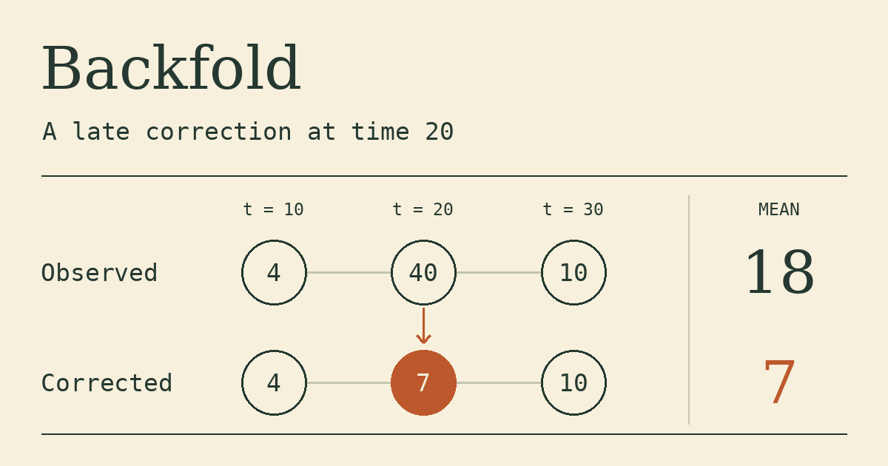

# Backfold

**Update a time-series statistic when an old reading changes.** Backfold is a Rust library with Python bindings. Feed it timestamped observations from your event consumer. When a sensor sends a correction, Backfold updates the affected summaries so your dashboard, model or alert can read the revised answer.

[Try a late edit in your browser](https://pgg898200-ship-it.github.io/backfold/) · [Install the Python package](https://pypi.org/project/backfold/) · [Agent guide](llms.txt)



## Correct one reading in Python

Install with `python -m pip install backfold`. A fork shares the original history until you edit it.

```python
from backfold import MomentsStream

observed = MomentsStream()
for t, value in [(10, 4.0), (20, 40.0), (30, 10.0)]:
    observed.upsert(t, value)

corrected = observed.fork()
corrected.upsert(20, 7.0)
print(observed.summary()["mean"], corrected.summary()["mean"])
# 18.0 7.0
```

Use `upsert` on the original stream to accept the correction directly. Use `retract` to remove a reading. An event key consists of event time, source ID and sequence number. The example uses the default source ID and sequence number, so a second write at time 20 replaces the first.

## Where it fits

Embed Backfold in the process that consumes events. Each supported operator keeps a tree of summaries in event-time order. With the operator and dimension fixed, a single edit touches O(log T) nodes for T events. The tree also supports historical range queries and O(1) forks. Your application owns ingestion and durable storage.

| Need | Start here |
| --- | --- |
| Recompute the mean, variance or extrema after a correction | `MomentsStream` |
| Smooth irregularly spaced measurements or revise an alarm time | `EwmaStream`, `CusumStream.first_alarm` |
| Revise the estimated trajectory after a late observation | [Kalman filtering and RTS smoothing](examples/kalman_rts_smoothing.py) |
| Inspect covariance, correlation, principal components or multivariate outliers | [Covariance and Mahalanobis scoring](examples/multivariate_anomaly_cov.py) |
| Update a regression when a delayed label arrives | `RidgeStream` |
| Reconstruct what was known at an earlier time or screen many channels for alarms | [Bitemporal queries and e-value screening](examples/polars_late_arrivals.py) |

A sequential pass has a lower initial cost for a one-off append-only aggregate. Dense covariance and ridge summaries grow quadratically with feature dimension. The architecture notes describe the operator costs and numerical assumptions. [Architecture](docs/ARCHITECTURE.md)

## Give an agent a CSV

The native CLI can summarize a local CSV into timestamped windows and drill back into the original file for raw rows. From a clone of this repository with Rust and Cargo installed, run the following commands.

```sh
cargo build --release --bin backfold
./target/release/backfold digest benchmarks/sample_100k.csv
./target/release/backfold drill benchmarks/sample_100k.csv --start 22498 --end 22507
```

For a desktop client that opens MCP bundles, install the [Backfold 0.3.0 bundle](https://github.com/pgg898200-ship-it/backfold/releases/download/v0.3.0/backfold-0.3.0.mcpb). The package supports Apple Silicon macOS, Windows x86-64 and Linux x86-64. [Official MCP Registry entry](https://registry.modelcontextprotocol.io/v0.1/servers/io.github.pgg898200-ship-it%2Fbackfold/versions/0.3.0) · [Try it on a four-row CSV](integrations/mcpb/README.md)

For manual MCP configuration, set the command to the absolute path of that executable and the arguments to `["mcp"]`. The server uses standard input and output. Start with `backfold_digest_csv` for a summary and `backfold_drill_csv` for the underlying rows. The reference includes the tools for Kalman smoothing, covariance and channel screening. [Agent guide](llms.txt) · [API reference](llms-full.txt) · [Coding-agent skill](skills/backfold/SKILL.md)

## What does a late edit cost?

At 100,000 readings, the recorded Python moments benchmark took **6.06 µs median** to replace one reading, read the summary and restore the old reading. Recomputing the moments over the edited array took **273 µs in Polars** and **730 µs in NumPy**. The largest absolute difference across mean, variance, skewness and excess kurtosis was 4.55 × 10⁻¹⁶ (rounded up). These are warm, in-memory timings on the recorded Linux x86-64 run. They exclude initial tree construction and I/O.

The results also include native Rust baselines, range queries, a 64-fork workload and CSV digest evaluation. Run `./target/release/backfold bench` for native timings on your machine. [Benchmark method](docs/BENCHMARK_PROTOCOL.md) · [Recorded results (JSON)](benchmarks/results.json) · [Sequential reference implementations](benchmarks/oracles.py)

[Source license](LICENSE) · [CI](https://github.com/pgg898200-ship-it/backfold/actions/workflows/ci.yml) · [Compare related tools](docs/PRODUCTS.md) · [PGG engineering tool directory](https://github.com/pgg898200-ship-it/streamsieve/blob/main/PRODUCTS.md)
